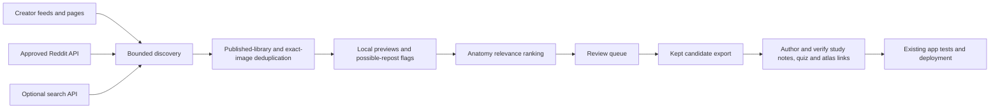

# Meme discovery pipeline

The collector finds **candidates**, with local previews, source credits and anatomy relevance scores. A separate review step keeps promising images for lesson authoring. It never changes `src/memeImages.ts`, `src/memeLessons.ts`, or the live app.



## Run locally

From the repository root:

```sh
python3 -m venv .venv-memes
.venv-memes/bin/python -m pip install -r tools/meme_harvest/requirements.txt
npm ci
.venv-memes/bin/python -m tools.meme_harvest doctor
.venv-memes/bin/python -m tools.meme_harvest collect
.venv-memes/bin/python -m tools.meme_harvest review --serve
```

Open **http://127.0.0.1:5194/**. Search by topic or caption, inspect the full image and original source, then keep or reject a candidate. Keeping requires a description of the actual joke or punchline, a reviewer, a specific learning hook, visible learning evidence, an image-supported recall question with its answer, creator credit and reuse notes. Anatomy relevance alone does not qualify an image: plain diagrams, labeled charts, lecture slides and instructional animations are excluded. These notes record what still needs checking; keeping is not publication approval or a finding that reuse rights are cleared.

The state lives in `.meme-harvest/`, which Git ignores. It includes the SQLite queue, local WebP previews, conditional-request cache, the latest run report and a static `review.html`. The static page works offline for browsing; saving decisions needs the local server. The server binds only to loopback and accepts same-origin JSON decision requests.

Once the virtual environment is activated, `npm run memes:collect`, `npm run memes:review` and `npm run memes:test` provide the same entry points. Optional `--ocr` uses an already-installed `tesseract`; it never downloads OCR software or sends images to an AI service. Without OCR, the gallery explicitly flags the need to inspect text readability.

Useful commands:

```sh
# Rebuild the published-image registry from the actual app catalogue.
.venv-memes/bin/python -m tools.meme_harvest init

# Smaller run, or one source at a time.
.venv-memes/bin/python -m tools.meme_harvest collect --max-images 10 --max-requests 40 --source imgflip-anatomy

# Add a source page or a specific image found while browsing.
.venv-memes/bin/python -m tools.meme_harvest add 'https://creator.example/comic' --image 'https://creator.example/comic.png' --title 'A specific anatomy joke'

# Export the kept queue for lesson writing.
.venv-memes/bin/python -m tools.meme_harvest export
.venv-memes/bin/python -m tools.meme_harvest stats
```

Global `--state /path/to/queue` and `--config /path/to/sources.json` precede the subcommand. Use a separate state directory to inspect a downloaded scheduled-run queue without replacing your local decisions.

## Sources and automatic runs

Source configuration is in `tools/meme_harvest/sources.json`. The enabled sources are Imgflip's anatomy gallery, PickleZombie RSS and Nashville PT RSS. Amoeba Sisters is disabled and editorially excluded: its instructional diagrams and animations do not qualify as memes. Exclusions are enforced on source IDs, source/image domains and recognizable creator credits, including reposts. Restored queues automatically move matching candidates to Rejected; neither review controls nor export can re-approve them. A GIF's preview is its first frame and is labeled accordingly. Source failures are recorded and do not stop other sources. Gallery images retain their individual post link when it is available.

`.github/workflows/meme-discovery.yml` runs daily at **11:20 UTC**, on changes to the collector, and from GitHub Actions → **Meme candidate discovery → Run workflow**. It collects at most 20 images within 80 requests, runs the collector tests, restores a cached queue, and uploads a seven-day `meme-review-queue` artifact. Gallery sources can follow up to three same-host “next” pages; Imgflip is capped at eight images per run so it does not consume the entire batch. Unzip the artifact to browse `review.html`; point `--state` at its directory to save decisions using the local server. Scheduled runs never commit candidates or deploy the app. GitHub's cache is best-effort and can be evicted, so keep your reviewed SQLite queue locally. The published app registry still protects against collecting shipped images again after cache loss.

### Reddit

The Reddit connector is disabled by default. Reddit's [Responsible Builder Policy](https://support.reddithelp.com/hc/en-us/articles/42728983564564-Responsible-Builder-Policy) requires approved API access. Enable it only with access approved for this purpose, then configure environment variables:

```sh
export REDDIT_APPROVED=1
export REDDIT_ACCESS_TOKEN='your-approved-short-lived-token'
export REDDIT_USER_AGENT='platform:your-app-id:version (by /u/your-account)'
```

Use your approved token acquisition/renewal process; this tool does not register apps, accept terms, or mint credentials. It queries the configured subreddit searches through `oauth.reddit.com`, handles static images and galleries, and skips NSFW, removed and video posts. It never falls back to scraping Reddit HTML or unauthenticated JSON. Review your approved data-retention requirements before enabling it on a schedule; the prototype does not yet refresh deletion status for previously collected posts. Do not put tokens into the JSON source file or commit them.

### Optional web search

The Brave connector uses the [official Web Search API](https://api-dashboard.search.brave.com/app/documentation/web-search/get-started). Supply your own `BRAVE_SEARCH_API_KEY` and enable `web-search` in source configuration. No paid account is created and no search key is bundled. Search results feed the same bounded page/image pipeline. Reddit results are reported as leads for the approved connector rather than scraped. The default scheduled workflow uses only public sources and does not pass API secrets.

## What the score means

The score uses **specific anatomy terms**, image dimensions and whether a source identifies itself as the original creator. Muscle/bone terms receive extra weight. The matches and flags are displayed alongside the score. It does not verify anatomy, licensing, humor, or whether a cartoon is truly a meme. There is no automatic “funny enough” threshold.

Exact file hashes and known image URLs are suppressed as duplicates. Pinterest size variants and Reddit image-preview URLs normalize to stable media keys. Perceptual difference hashes identify **possible** reposts: those remain reviewable because two captions on the same meme template can be different jokes. The registry is seeded from the actual shipped app catalogue, currently 54 reviewed images (20 active and 34 retired for weak educational value). Retired images stay in duplicate detection to prevent their return. New app images enter it on the next run. Repeated collection preserves keep/reject decisions.

Networking checks robots rules for ordinary pages and images, checks redirect destinations, rejects nonpublic network targets and non-web URL schemes, enforces per-host delays, request/image/response-size limits, validates decoded images, caches with ETag/Last-Modified, and defers hosts after 429/503 using Retry-After. Unavailable robots rules defer a source, while 404/410 robots files allow access. Authentication headers stay on their original host and authenticated responses are not cached.

## Publication and next iteration

`kept-candidates.json` exports source URLs, image paths, credits, matching topics and review notes. Author the mini-lesson and three distinct recall questions, verify against primary anatomy references, choose real atlas target IDs, produce local app images, then run the existing app checks before adding a candidate to the live library. The collector has no publication credentials or app-writing command.

Next useful additions are: approved Reddit ingestion with deletion refresh; a search provider key for wider discovery; an editable seed-source list in the review interface; retention/cleanup controls; and optional AI-assisted caption extraction/topic suggestions. Any AI lesson drafting should retain source citations and receive a factual review before publication.

Tests:

```sh
.venv-memes/bin/python -m unittest tools.meme_harvest.test_harvest -v
npm test
npm run build
```

## Educational value is required in the image

Review both requirements: an actual joke and a concrete, correct recall cue. Quote the visible text or describe the visual relationship, then write one question **with its answer** that the image helps a student recall. An unrelated study card does not count. `decide` accepts these as `--evidence` and `--recall`; server and export enforce both fields, including when old queues are restored. These fields require human judgment; they are not an automated assessment of educational quality.

Prefer muscle/bone identification, location, action, attachments and innervation, followed by mechanisms and meaningful comparisons. A highlighted trapezius with “It’s a trap,” the carpal-name mnemonic, and osteoblast builders versus osteoclast demolition pass. “Anatomy is hard,” a generic nervous-system pun, and a list of difficult exam topics fail. Naming a muscle without showing or explaining any useful distinction also fails. Misleading images fail even if the linked notes could correct them.

The [visual audit](meme-education-audit.md) documents all 54 app records: 20 retained, 34 retired. Twelve existing queued images were also rejected; their exact image URLs are persisted in the editorial rules so cached scheduled queues receive those decisions. Source-wide exclusions continue to apply separately.
